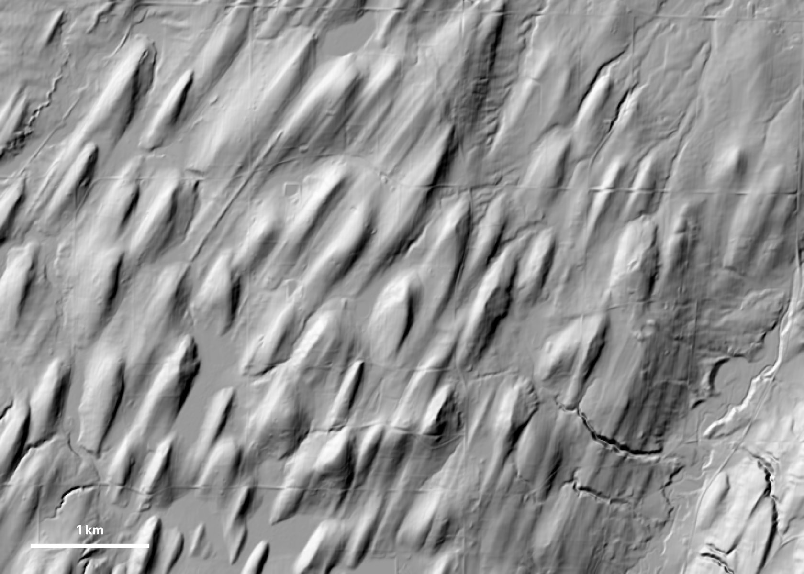
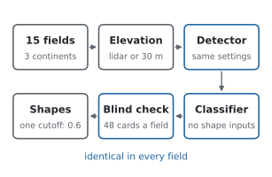
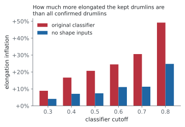
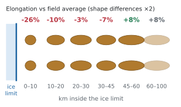
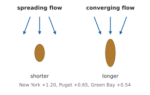

# How Drumlins Form: Evidence from 15 Fields

*By James ([Barneyjm](https://github.com/Barneyjm) on GitHub) · November 2026 · revised after review*

**In short:** inside a single drumlin field, drumlins close to the old ice edge are stubbier, and drumlins where the ice flow converged are longer. Both patterns fit the idea that drumlins keep lengthening the more, or the faster, ice slides over them. A bed instability seems to set their starting size. Across 15 fields on three continents these within-field patterns hold up, but the differences *between* fields remain unexplained.

[Try the simulator](simulator.md){ .md-button .md-button--primary } [Get the data and code](code-and-data.md){ .md-button }

!!! warning "Amateur study, not peer-reviewed"
    I'm not a geologist, and most of the analysis was done with Anthropic's Claude Opus. An independent review found real problems. This version fixes them or flags them; see [Caveats](#caveats) and [What changed after review](#what-changed-after-review).

## What drumlins are and why they matter

A drumlin is a streamlined hill shaped by an ice sheet flowing over its bed, with its long axis along the ice flow. Textbooks draw it blunt at the up-ice end and tapering down-ice. Large surveys find most drumlins are closer to symmetrical bumps ([Spagnolo et al., 2011](https://research.manchester.ac.uk/en/publications/the-topography-of-drumlins-assessing-their-long-profile-shape)). Most are 250–1,000 m long and 120–300 m wide ([Clark et al., 2009](https://www.sciencedirect.com/science/article/abs/pii/S0277379108002540)). They are usually only a few metres high; the average in Britain is about 7 m ([Spagnolo et al., 2012](https://www.sciencedirect.com/science/article/pii/S0169555X12001055)). They come in fields of hundreds to thousands, often called a "basket of eggs" landscape. The name comes from the Irish *droimnín*, "little ridge". Large fields cover parts of New York, Wisconsin, Minnesota, Michigan, Canada, Ireland and Britain. Most were left by ice sheets of the last glaciation, and drumlins are still forming today under some glaciers, such as Múlajökull in Iceland.

<figure markdown="span">
  
  <figcaption>About 7 × 5 km of the Central New York drumlin field, near the north end of Canandaigua Lake (USGS 3DEP 10 m elevation, lit from the northwest, relief exaggerated). Ice flowed roughly north-northeast to south-southwest, along the long axes of the hills.</figcaption>
</figure>

**Why they matter.**

- **They record how ice sheets moved.** Drumlins line up with the flow, so geologists use them to map where vanished ice sheets went and how their flow changed as they retreated.
- **They are a window on the ice-sheet bed.** How fast an ice sheet slides depends on what happens where ice meets soft, wet sediment. That is one of the least certain parts of forecasting how fast Antarctica and Greenland lose ice to the sea. The bed of a living ice sheet is almost impossible to observe, and old drumlin fields are its exposed floor.
- **How they form is still debated.** Geologists have argued about it since the 1800s. Drumlins can be made of till, gravel or bedrock, so their contents alone do not settle it. Ideas range from ice moulding soft sediment, to meltwater floods, to a bed instability that grows bumps of a preferred size, like ripples in sand.

## Summary

| Claim | Confidence | Main evidence |
| --- | --- | --- |
| Drumlins are stubbier within about 60 km of the maximum ice limit | Moderate | +0.28 ± 0.11 with a separate slope for each field; holds among hand-checked drumlins only (+0.27 ± 0.09); also at Múlajökull. Detection precision is only about 40% within 20 km of the limit. |
| Converging ice flow goes with longer drumlins | Moderate | New York +1.20, Puget +0.65, Green Bay +0.54; a noise null test gives about 0 |
| Margin and convergence effects share one coefficient across fields | Rejected | Per-field slopes differ widely |
| Drumlin size is consistent with the Fowler & Chapwanya instability scale | Weak (a consistency check) | Implied lD ≈ 400–450 m, inside the theory's plausible range |
| Till texture controls elongation | Not supported | No within-field link with clay, sand or stones |
| Field-to-field differences in elongation | Unexplained | Nothing tested predicts them, and field rankings changed when the detector was corrected |

Each within-field control explains only about 1–2% of the variation between individual drumlins; most of that variation is local.

## What this adds

Most of the ideas here have been raised before: drumlins shortening toward the ice limit was noted in Wisconsin a century ago ([Alden, 1918](https://npshistory.com/series/science/2/chap5.htm)). What this study adds is mainly method and scale. The list is limited to what survived the review, and our literature reading was not exhaustive.

### One method, checked for bias, across 15 fields

Automated drumlin mapping is not new ([Saha et al., 2011](https://www.sciencedirect.com/science/article/abs/pii/S0098300411001324)), but large inventories are still usually mapped region by region by hand. Here one detector, one classifier and one cutoff were run over 15 fields in North America, Britain, Ireland and Patagonia, and each field was checked blind.

<figure markdown="span">
  
  <figcaption>The same pipeline runs in every field, so shapes can be compared without differences in mapping style.</figcaption>
</figure>

### A measured shape bias in drumlin classifiers

Our first classifier used length, width and elongation to decide what counts as a drumlin, so it favoured long, thin hills. Among hand-checked drumlins, the ones it kept at the 0.7 cutoff were 31% more elongated than all of them. Using a different cutoff in each field made between-field comparisons meaningless. A classifier with no shape inputs is almost as accurate (AUC 0.84 against 0.86) and cuts the bias to about 11% at the cutoff now used. Any automated drumlin inventory that classifies on shape is likely to carry this kind of bias.

<figure markdown="span">
  
  <figcaption>How much more elongated the kept drumlins are than all hand-checked drumlins, by cutoff (blocked cross-validation on 448 confirmed drumlins).</figcaption>
</figure>

### The margin gradient, tested across several ice sheets

Drumlins get stubbier toward the maximum ice limit, out to about 60 km. Alden (1918) saw this in the Green Bay Lobe. Here it holds in every cold-margin field near a dated limit: Green Bay, Langlade and Pierz (Laurentide) and Magellan–Otway (Patagonia). It also appears at a modern Icelandic surge glacier, and among hand-checked drumlins only. Puget, under temperate Cordilleran ice, shows none.

<figure markdown="span">
  
  <figcaption>Average elongation by distance band, relative to each field's mean (pooled over 5 fields). Shape differences are drawn twice as large as measured.</figcaption>
</figure>

### Converging flow, with a null test

Where ice flow converged, which usually means faster ice, drumlins are longer. This fits [Hess & Briner (2009)](https://nsmsites.caset.buffalo.edu/briner/buf/pubs/Hess_and_Briner_2009.pdf), who explained New York elongation by ice velocity. Flow here is traced from the drumlins' own orientations. Stubby drumlins have noisier orientations, so we checked that this noise alone cannot create the pattern: simulated noise gives a slope of about zero.

<figure markdown="span">
  
  <figcaption>Slope of log elongation on upstream flow convergence, with distance from the ice limit controlled for.</figcaption>
</figure>

## Where this meets existing work

| Existing idea | What we found |
| --- | --- |
| **Bed instability sets drumlin size** ([Fowler & Chapwanya, 2014](https://royalsocietypublishing.org/doi/10.1098/rspa.2014.0185)) | **Consistent, but a weak test.** Observed sizes imply a length scale of about 400–450 m, inside the wide range the theory allows (190 m to 3.4 km). |
| **The same theory: bedform type depends mainly on till grain size**, and only weakly on ice speed | **Not supported where we could test it.** Till texture from soil surveys shows no within-field link with elongation. An earlier version of this page said the theory predicts stubbier drumlins under faster ice. That was our own extrapolation, not the paper's claim, and is withdrawn. |
| **Elongation reflects ice velocity** ([Hess & Briner, 2009](https://nsmsites.caset.buffalo.edu/briner/buf/pubs/Hess_and_Briner_2009.pdf), New York) | **Consistent.** Converging, faster flow goes with longer drumlins in New York, Puget and Green Bay. |
| **Drumlins shorten toward the ice limit** ([Alden, 1918](https://npshistory.com/series/science/2/chap5.htm), Green Bay Lobe, which he put down to slower, spreading ice) | **Confirmed in more ice sheets.** Our data cannot tell slower ice from shorter time under ice as the cause. |
| **Elongation grows with cumulative slip** ([Zoet et al., 2021](https://onlinelibrary.wiley.com/doi/10.1002/esp.5192)) | **Cannot be separated from distance here.** Our slip estimate is built from distance and time, so it adds nothing beyond them. Zoet et al.'s flowline method would be the proper test. |
| **A frozen outer margin shaped Green Bay drumlins** ([WGNHS, 2019](https://data.wgnhs.wisc.edu/pubshare/WOFR2019-02.pdf)) | **Not required for the gradient.** The same inward gradient appears under warm-based ice at Múlajökull. It may still matter in Green Bay. |
| **Drumlins are regularly spaced** ([Clark et al., 2018](https://eprints.whiterose.ac.uk/id/eprint/118197/)) | **Not seen in New York**, where spacing looked like randomly packed hills. That test used the earlier, biased selection and has not been rerun. |
| **Drumlins grow longer and wider over time** ([Ely et al., 2018](https://eprints.whiterose.ac.uk/id/eprint/120713/)) | **An earlier claim that width stays fixed is withdrawn.** With unbiased selection, width and length vary between fields by similar amounts. |

## Caveats

- **Who did this.** I'm not a geologist and have no training in glacial geomorphology. The analysis was done with Claude Opus. Drumlin labels came from me and from Claude Opus, Claude Sonnet and Claude Haiku, not from trained mappers, so "precision" means agreement with non-expert labels.
- **Not peer-reviewed.** An AI reviewer acting as a geomorphologist found the problems listed below; no human geologist has checked the work.
- **Detection errors.** Precision is 54–82% per field. Within 20 km of an ice limit it falls to about 40%, because moraine hummocks and kames are common there, and these false positives are stubby. The margin gradient also holds among hand-checked drumlins, but on fewer cases (234).
- **Only the big drumlins.** Compared with expert hand maps in two fields, we find only 7–10% of mapped drumlins, mostly the larger ones. Our outlines are about 22% shorter than an expert's for the same hill. Results describe the larger drumlins in each field.
- **Remaining shape bias.** The labels themselves may favour classic elongated hills, and the corrected classifier still keeps hills about 11% more elongated than the average confirmed drumlin.
- **Coarse inputs.** Copernicus 30 m elevation outside the US is a surface model that includes trees and buildings. Ice-margin reconstructions are generalised, and their uncertainty is similar in size to the nearest distance band. Soil data come from map units, not boreholes.
- **Choices made after looking.** The 60 km break and the "cold-margin" grouping were chosen after seeing the data. Treat their exact values as provisional.
- **Correlation, not mechanism.** The results describe how shape varies; they do not show what causes it.

## What changed after review

The first version (November 3) made claims the data do not support. A review on November 4 led to these changes:

- **Classifier.** Retrained without shape inputs, with one cutoff (0.6) for every field. Chippewa failed the new checks and was dropped, leaving 15 fields and 13,607 drumlins.
- **Withdrawn:** "width is nearly fixed while length varies"; cumulative slip as independent evidence; the claim that Fowler & Chapwanya predict stubbier drumlins under faster ice; "high confidence" for the margin gradient.
- **Strengthened:** the margin gradient (+0.16 to +0.24 pooled) and convergence (New York +0.92 to +1.20) under the corrected selection.
- **Corrected:** background facts on drumlin height and shape, and the literature now credited.
- **Validated against expert maps** (BRITICE, Vale of Eden and Cavan–Monaghan): precision agrees with our blind checks, but recall is low and biased toward large drumlins (see [Data and methods](methods.md#validation-against-expert-maps)).
