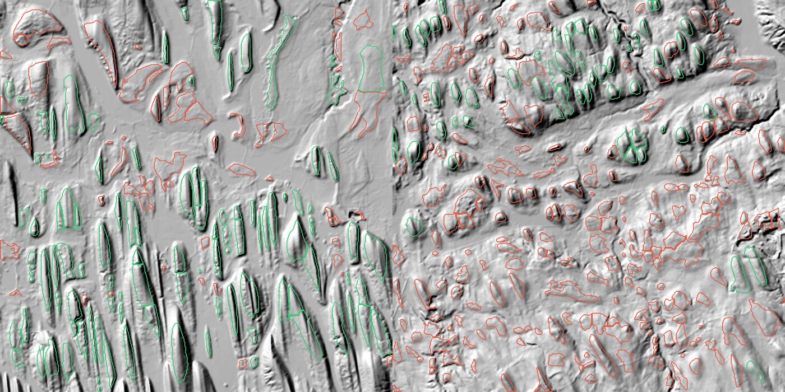
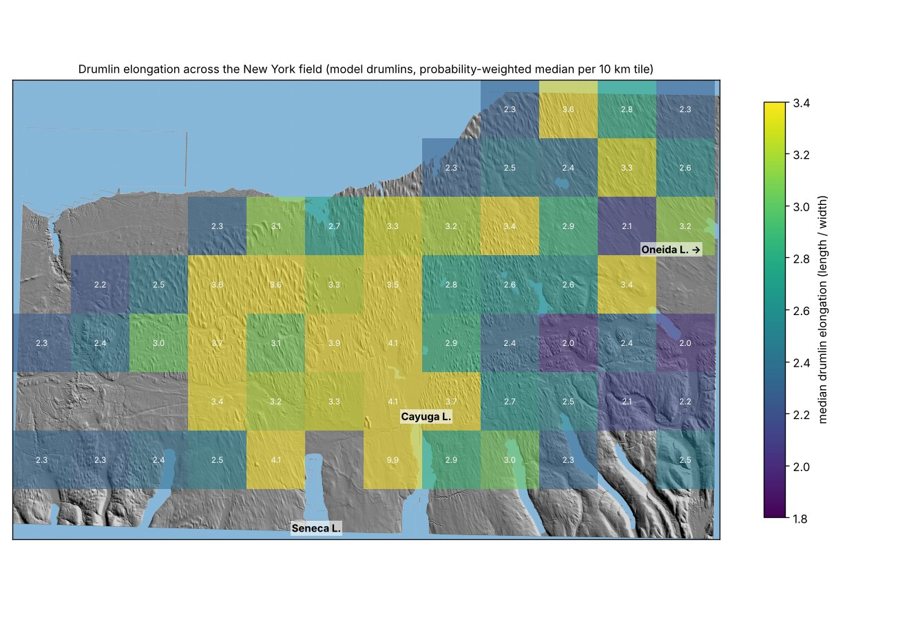

# Data and methods

We tried 26 fields. 15 passed quality checks and hold 13,607 accepted drumlins, picked from over 300,000 candidate hills.

## Elevation

- **US:** USGS 3DEP 1/3 arc-second (about 10 m) elevation.
- **Canada, Ireland and Patagonia:** Copernicus GLO-30. This is a 30 m *surface* model, so it includes trees and buildings, which can distort hill outlines.
- **Vale of Eden:** England Environment Agency 1 m lidar.
- **Poland:** national lidar.
- **Múlajökull:** 2 m ArcticDEM.

Everything was resampled to 20 m in UTM (4 m in Iceland). Hills narrower than about 40 m (two pixels) cannot be outlined reliably.

## Detection

Hills come from top-hat relief and an h-maxima watershed, with road cuts filled by grey closing. Outlines are trimmed at half height. Length, width and azimuth come from each footprint's second moments.

## Classification

A gradient-boosted classifier decides which hills are drumlins. It was trained on 1,385 labelled hills from Central New York, Green Bay and Puget. The labels came from James and from Anthropic's Claude Opus, Claude Sonnet and Claude Haiku. Agreement with James was κ = 0.83 for Claude Opus, 0.69 for Claude Sonnet and 0.33 for Claude Haiku.

The classifier uses no length, width or elongation. Its inputs are:

- **The hill:** area, height, top-hat relief, slopes and outline regularity.
- **Its neighbours:** how many hills sit nearby, how well their orientations agree, and their heights.

One cutoff, 0.6, is used everywhere. In blocked cross-validation it gives ROC-AUC 0.84 and precision about 0.71.

The first version also fed length, width and elongation to the classifier and used a different cutoff in each field (0.25–0.85). That biased the selection toward long hills: among hand-checked drumlins, those kept at 0.7 were 31% more elongated than all of them. The current classifier still keeps hills about 11% more elongated than average at 0.6, but the bias is now the same in every field.

<figure markdown="span">
  
  <figcaption>Detected hills on two New York hillshade windows. Green outlines were accepted and red rejected; this image is from the first classifier.</figcaption>
</figure>

## Quality control

Each field got 48 blind cards: 36 hills the first classifier accepted and 12 it rejected. The cards were labelled by Claude Opus or Claude Sonnet. Precision for the current selection is estimated from these cards, weighted by how common each group is in the field. For New York, Green Bay and Puget it comes from cross-validation on the training labels.

Precision is 54–82% per field. It is much lower near ice limits: about 38% within 20 km, 72% at 20–60 km and 88% beyond 60 km.

## Validation against expert maps

Two fields overlap the BRITICE v2 database of hand-mapped glacial landforms ([Clark et al., 2018](https://onlinelibrary.wiley.com/doi/10.1111/bor.12273)). In the Vale of Eden, BRITICE has drumlin outlines compiled from Hughes et al. (2010), Livingstone et al. (2008) and Mitchell & Riley (2006). In Cavan–Monaghan it has drumlin crest lines and ribbed-moraine outlines. The comparison only covers 2 km cells where mappers recorded drumlins.

| | Vale of Eden | Cavan–Monaghan |
| --- | --- | --- |
| Our accepted hills that match a mapped drumlin | 72% (340 of 472) | 85% (915 of 1,076) |
| Mapped drumlins we accept (recall) | 7% of 4,336 | 10% of 8,663 |
| Our accepted hills inside mapped ribbed moraine | 1% | 67% |

What this shows:

- **Precision holds up.** Agreement with expert maps (72% and 85%) is close to our blind-card estimates (79% and 81%). The hills that match no mapped drumlin have the same median elongation as those that do, so the false positives here do not skew shape.
- **We find only the big drumlins.** Recall is about 7–10%. It rises with size: 22% of mapped drumlins longer than 1.2 km are found in the Vale of Eden, none shorter than 300 m. The ones we find are more elongated than the ones we miss (hand-measured E 2.99 against 2.48). Our results describe the larger, higher-relief drumlins in each field, not the whole population.
- **Our outlines are short.** For 311 drumlins in both maps, our outlines (trimmed at half height) give a median length of 620 m against 825 m for the hand outlines, with similar widths. So our elongation is about 22% lower than an expert's for the same hill. Rank agreement is only 0.34 for elongation. That noise weakens real relationships rather than creating false ones, but absolute elongation values are not comparable with hand-mapped studies.
- **Cavan–Monaghan is partly ribbed moraine.** Two-thirds of our accepted hills there also lie inside mapped ribbed moraine. Many are drumlinised ribs, which may explain why it has the lowest elongation of any field.

Neither field lies near an ice limit, so this does not test the low precision near margins. That needs a hand map from a near-margin field such as the Green Bay Lobe (see [Open questions](open-questions.md)).

## Ice history

- **North America:** NADI-1, in 0.5 ka slices.
- **Britain and Ireland:** DATED-1.
- **Patagonia:** PATICE.
- **Múlajökull:** surge limits from Sigurkarlsson's thesis.

Each drumlin's distance inside the maximum limit is measured to the outermost reconstructed margin.

## Flow

Flow direction comes from the drumlins' own orientations, smoothed over 4 km. Convergence is the narrowing of a flux tube integrated 10 km upstream. A null test checks that orientation noise on stubby drumlins does not create a link between convergence and elongation (see [Stage 2](stage-2-lengthening.md)).

A shallow-ice model on ETOPO beds was also calibrated to drumlin directions in New York (median error 11°), Green Bay (21°) and Puget (19–21°).

## Exposure

Time under ice comes from the margin slices. A cumulative-slip estimate uses a plastic ice profile, with slip speed proportional to √(distance from the margin), summed over the time each drumlin was covered. Because it is built only from distance and time, it is not independent evidence.

## Soils

Till clay, sand and stone content come from USDA SSURGO, using till-parent map units. Soil data are only available for the US fields.

## Statistics

All tests use field fixed effects with errors clustered by 5 km blocks. The headline margin slope also comes from a mixed model with a separate random slope for each field, which accounts for differences between fields. The 60 km break and the cold-margin grouping were chosen after looking at the data.

<figure markdown="span">
  
  <figcaption>Median drumlin elongation per 10 km tile across Central New York (first classifier).</figcaption>
</figure>
