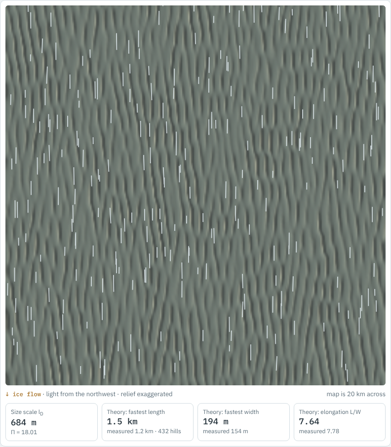

# Simulator

An interactive toy of the bed instability: drag the sliders for ice speed, ice viscosity, till–water coupling (Π) and growth time, and watch a field of bumps grow into ribs or streamlined drumlins.

[Open the simulator](sim/index.html){ .md-button .md-button--primary }

{ width="560" }

The simulator is illustrative. Its growth rates follow the linear instability described in [Stage 1](stage-1-size.md); it does not include the within-field lengthening found in [Stage 2](stage-2-lengthening.md).
