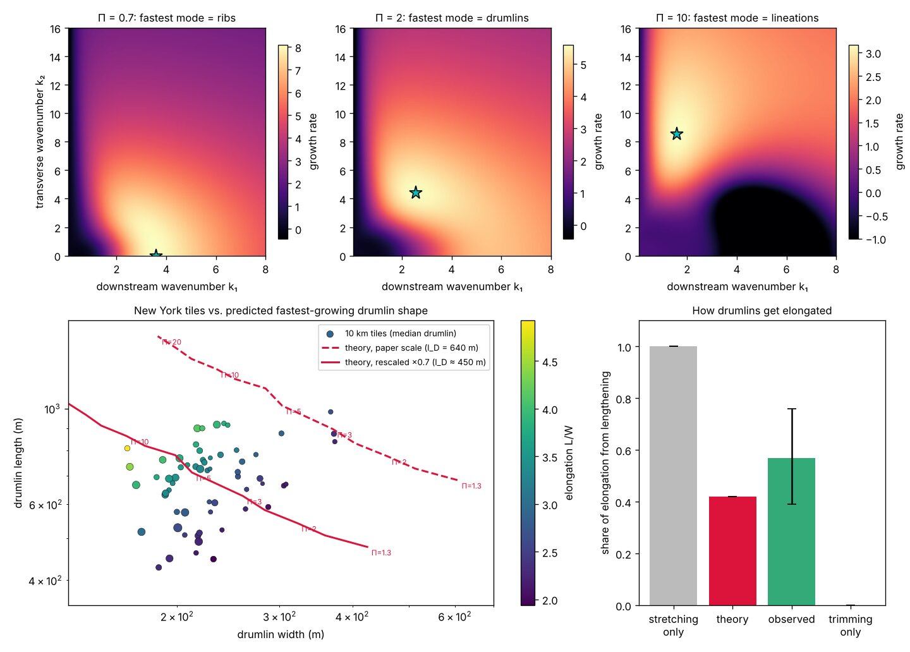
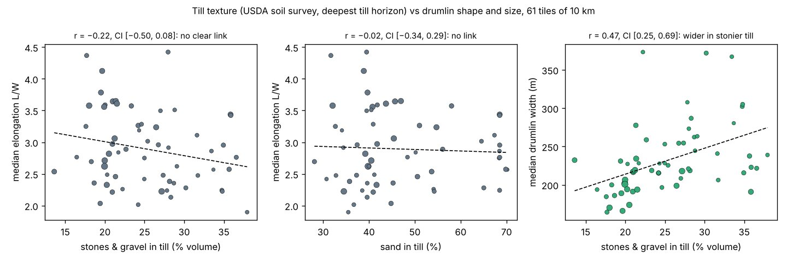

# Stage 1: size and spacing

The Fowler & Chapwanya instability gives a size scale that fits observed drumlins. The theory allows such a wide range, though, that the fit is a weak test. The theory's main prediction, that till grain size controls bedform type, is not supported where we could test it.

## The length scale

In the [Fowler & Chapwanya (2014)](https://royalsocietypublishing.org/doi/10.1098/rspa.2014.0185) ice–water–till model, bumps on a soft bed grow at a rate that depends on their wavelength. The natural scale is:

$$
l_D = \sqrt{\frac{\eta \, u}{\Delta\rho \, g}}
$$

Here:

- η is ice viscosity;
- u is sliding speed;
- Δρ ≈ 83 kg/m³ is the water–ice density difference;
- g is gravity.

For η = 3×10¹³–3×10¹⁴ Pa·s and u = 30–1,000 m/a, lD runs from 190 m to 3.4 km. Observed drumlin sizes imply lD ≈ 400–450 m. That sits inside this range, but almost any drumlin size would.

## What grows fastest

Our re-derivation of the growth rate (a 4×4 determinant, checked against the paper's quadratic) gives these shapes for the till–water coupling parameter Π:

| Π | Fastest length L\* | Fastest width W\* | L\*/W\* |
| --- | --- | --- | --- |
| 1.3 | 1.05 lD | 0.98 lD | 1.1 |
| 4 | 1.54 lD | 0.48 lD | 3.2 |
| 20 | 2.16 lD | 0.28 lD | 7.7 |

Low Π favours broad ribs across the flow; high Π favours long, narrow hills. The paper ties Π mainly to till grain size and says its dependence on ice speed is weak.

<figure markdown="span">
  
  <figcaption>Top: growth rate of bed bumps by downstream and transverse wavenumber for three values of Π; stars mark the fastest-growing mode. Bottom left: New York 10 km tiles against the predicted fastest-growing shape. Bottom right: share of elongation that comes from lengthening. From the first classifier.</figcaption>
</figure>

## Till texture

Fowler & Chapwanya predict that fine-grained till favours long lineations and coarse till favours ribs or drumlins. We tested this with USDA soil-survey texture at 6,345 drumlins in 10 US fields.

- **Elongation:** within fields, it shows no link with clay, sand or stone content; each effect is under 3% per 10% change in texture and none is significant. Within 20 km blocks, only stone content shows a small effect, about +3% per 10% stones.
- **Size:** within fields, each extra 10% sand goes with drumlins about 6–7% longer and wider. Within 20 km blocks it shrinks to about 1.5–3%, so it partly reflects regional differences.

Soil map units are a coarse measure of the till actually inside a drumlin, so this is a weak test. Even so, it gives no support to grain size controlling shape.

<figure markdown="span">
  
  <figcaption>New York: till texture (deepest till horizon) against drumlin shape and size, 61 tiles of 10 km (first classifier).</figcaption>
</figure>

## Spacing

In New York, drumlin spacing was no more regular than randomly packed hills of similar size. That disagrees with [Clark et al. (2018)](https://eprints.whiterose.ac.uk/id/eprint/118197/), who found regular spacing in British drumlins. Our test used the first, biased selection and has not been rerun.

## Width and length between fields (withdrawn)

The first version said median width barely varies between fields while length does. With the corrected classifier, the spread of field medians is about the same for width (196–321 m) as for length (515–865 m): SD of the log medians 0.13 against 0.14. The earlier contrast came from the shape-based classifier and the different cutoffs in each field. This agrees with [Ely et al. (2018)](https://eprints.whiterose.ac.uk/id/eprint/120713/), who argue drumlins grow both longer and wider.
