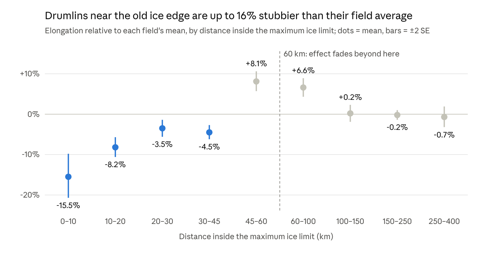

# Stage 2: lengthening

Within a field, drumlins get longer the more ice has flowed over them. The clearest sign is at ice-sheet margins: drumlins within 10 km of the maximum limit are about 16% stubbier than their field's average.

*11 fields, 15,955 drumlins with ice-limit distances (NADI-1, DATED-1, PATICE)*

**Margin gradient.** Within 60 km of the limit, log elongation rises with log distance at +0.16 ± 0.02 (5 fields), or +0.21 ± 0.03 counting only cold-margin ice-sheet fields. Beyond 60 km the slope is −0.18 ± 0.09. The gradient holds in each cold-margin field tested: Green Bay +0.27, Langlade +0.15, Pierz +0.26 and Magellan +0.10. Puget, under temperate Cordilleran ice, shows none. Between 45 and 100 km, drumlins run 7–8% above their field average before levelling off; with only 5–6 fields in those bins, that overshoot is not yet explained.

**Time under ice and cumulative slip.** Near margins, time under ice adds about 13% elongation per thousand years. Cumulative slip (slip speed integrated over cover time) gives a pooled slope of +0.21 ± 0.04, carried by length (+0.26), not width (+0.05). Adding cumulative slip absorbs the margin effect: distance drops from +0.18 to −0.12 (not significant). Our Green Bay slope of +0.26 matches Zoet et al. (2021), who found a robust positive link using flowline slip reconstructions.

**Converging flow.** Convergence measured from drumlin orientations lengthens drumlins: New York +0.92, Green Bay +0.41 and Puget +0.38, with distance controlled for. Green Bay's raw slope was −0.11 until margin distance was included, because flow spread out where the bed was briefly covered.

<figure markdown="span">
  
  <figcaption>Central New York. Left: ice-flow lines traced from drumlin orientations, with tile elongation as dots and flowline convergence shaded. Right: tile elongation rises with convergence over 20 km upstream (r = 0.63; partial r = 0.40 after controls).</figcaption>
</figure>

**Múlajökull, Iceland.** In this warm-based surge glacier's forefield, elongation rises inward from the outer moraine (+0.13 ± 0.04, 88 drumlins). Inside the 1954–1992 surge-moraine cluster, every drumlin went through the same surges, yet drumlins still lengthen inward (+0.20). That points to growth during quiet flow between surges, not to surge count. Jónsson et al. (2014) mapped the same trend.

<figure markdown="span">
  { width="420" }
  <figcaption>Múlajökull forefield on 4 m ArcticDEM hillshade, with the drumlins kept for analysis outlined.</figcaption>
</figure>

**Limits.** None of these exposure measures holds a shared coefficient across fields, and none predicts between-field differences. They describe how drumlins change within a field.
