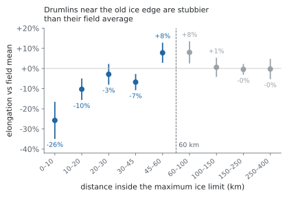
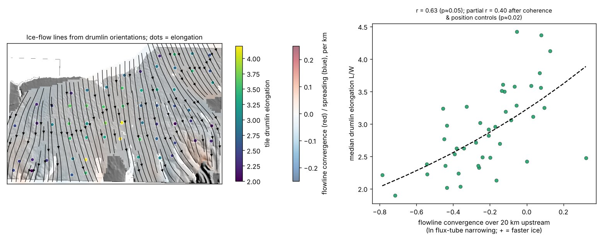
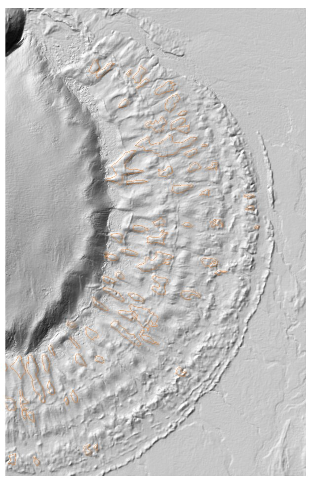

# Stage 2: lengthening

Within a field, drumlins are stubbier near the old ice edge and longer where ice flow converged. Both patterns fit drumlins lengthening the more, or the faster, ice slid over them. Our data cannot tell those two apart.

## The margin gradient

<figure markdown="span">
  
  <figcaption>11 fields, 11,844 drumlins with ice-limit distances (NADI-1, DATED-1, PATICE). Dots are means relative to each field's average; bars are ±2 standard errors across 5 km blocks.</figcaption>
</figure>

**Within 60 km of the maximum limit,** log elongation rises with log distance.

- **Pooled slope:** +0.24 ± 0.03, with errors clustered by 5 km blocks.
- **Allowing a separate slope for each field:** +0.28 ± 0.11 (p = 0.01). This is the more honest figure, since fields differ.
- **Cold-margin ice-sheet fields only:** +0.37 ± 0.12.
- **By field:** Green Bay +0.42, Langlade +0.17, Pierz +0.65 and Magellan–Otway +0.20. Puget, under temperate Cordilleran ice, shows none (0.00).

Drumlins within 10 km of the limit are about 26% stubbier than their field average.

**Beyond 60 km,** the slope reverses (−0.34 ± 0.11). Drumlins at 45–100 km run about 8% above their field average before levelling off. With only 5 fields in those bands, that overshoot is not explained.

**Is it misclassification?** Moraine hummocks, kames and other ice-contact hills are common near ice limits. Our detection precision falls there: about 38% within 20 km, against 72% at 20–60 km and 88% beyond 60 km. The false positives are stubby (median elongation 2.1, against 3.3 for true drumlins), so they could fake the gradient. Two checks say the gradient is real:

- **Hand-checked drumlins only.** Among 234 hills within 60 km that labellers confirmed as drumlins, with no classifier involved, the slope is +0.27 ± 0.09 (p = 0.002).
- **Stricter cutoffs.** Raising the cutoff, which removes more false positives, makes the slope steeper: +0.27 at 0.7, +0.32 at 0.8 and +0.41 at 0.9.

The near-limit averages in the chart still include many non-drumlins, so the −26% figure is not reliable on its own.

## Time under ice

Near margins, time under ice (from the NADI-1 margin slices, US fields) adds about 25% elongation per thousand years on its own (+0.22 in log units). Fitted together with distance, the two share the effect: about +13% per thousand years and +0.18 for log distance. They are correlated (r = 0.51), so we cannot cleanly separate time from position. [Alden (1918)](https://npshistory.com/series/science/2/chap5.htm) put the shortening toward the Green Bay limit down to slower, spreading ice, which is a third possibility.

## Cumulative slip

A cumulative-slip estimate (slip speed integrated over the time each drumlin was covered) correlates with elongation: +0.27 ± 0.05, carried by length (+0.27) rather than width (+0.01). But the estimate is built from distance and time alone. With distance in the same model, slip adds nothing (−0.10, p = 0.37). The first version presented slip as explaining the margin effect; it does so only by re-expressing distance. A proper test needs independent slip reconstructions, such as the flowline method of [Zoet et al. (2021)](https://onlinelibrary.wiley.com/doi/10.1002/esp.5192).

## Converging flow

Flow convergence, measured from the drumlins' own orientations over 10 km upstream, goes with longer drumlins. With distance from the limit controlled for:

- New York +1.20
- Puget +0.65
- Green Bay +0.54

In Green Bay the raw slope is negative, because flow spread out near the margin where drumlins are also stubby.

**Null test.** Stubby drumlins have noisier orientations (about 13° rms scatter, against 4° for the most elongated). Noise could in principle make flow look divergent where drumlins are stubby. We gave each field a uniform flow with no real convergence, added orientation noise matched to each drumlin's elongation, rebuilt the flow field and refitted. In all three fields the null slopes average about zero. Orientation noise does not create the pattern.

Convergence into troughs can also mean thicker ice, not only faster ice, so this is evidence about flow concentration rather than speed alone.

<figure markdown="span">
  
  <figcaption>Central New York (first classifier). Left: ice-flow lines traced from drumlin orientations, with tile elongation as dots and convergence shaded. Right: tile elongation rises with convergence over 20 km upstream.</figcaption>
</figure>

## Múlajökull, Iceland

Múlajökull is a warm-based surge glacier, so its bed is not frozen. In its forefield, elongation rises inward from the outer moraine: +0.13 ± 0.04 over 88 drumlins, detected separately from 4 m ArcticDEM. Every drumlin inside the 1954–1992 surge-moraine cluster went through the same surges, yet drumlins there still lengthen inward (+0.20). That points to growth during quiet flow between surges rather than to surge count. [Jónsson et al. (2014)](https://www.lunduniversity.lu.se/publication/8eaf9425-c4a4-4afd-b801-c26af5c2f655) mapped the same trend.

<figure markdown="span">
  { width="420" }
  <figcaption>Múlajökull forefield on 4 m ArcticDEM hillshade, with the drumlins kept for analysis outlined.</figcaption>
</figure>

## Limits

None of these effects shares one coefficient across fields, and none predicts the differences between fields. They describe how drumlins change within a field. Each explains only about 1–2% of the variation between individual drumlins.
