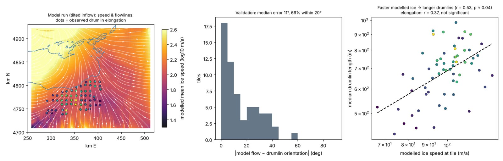

# What did not hold

These ideas failed, could not be tested, or were withdrawn after review.

## Withdrawn after review

| Earlier claim | Why it was withdrawn |
| --- | --- |
| Median width barely varies between fields while length does | It came from the shape-based classifier and the different cutoffs in each field. With the corrected selection, width and length vary by similar amounts. |
| Cumulative slip explains the margin effect | The slip estimate is built from distance and time. With distance in the model, slip adds nothing (−0.10, p = 0.37). |
| The instability theory predicts stubbier drumlins under faster ice, and the data contradict it | The speed exponents were our own extrapolation. Fowler & Chapwanya say speed matters only weakly and that till grain size is the main control. |
| Field-by-field elongation rankings | Rankings changed substantially when the classifier was corrected (rank correlation 0.32 with the old order). |
| High confidence in the margin gradient | Precision near ice limits is about 40%, and fields differ. It is now rated moderate, supported by a test on hand-checked drumlins. |

## Tested and not supported

| Idea | Test | Result |
| --- | --- | --- |
| One ice-speed law for shape | Elongation vs modelled speed, 3 fields | Slopes New York +0.65, Green Bay −0.48, Puget −0.67; a shared slope is rejected (p &lt; 0.001). The model is coarse (2 km grid, speed not calibrated). |
| Till texture sets shape | SSURGO texture, within fields | No link with elongation |
| Frozen bed needed for stubby margin drumlins | Margin gradient under warm-based ice | Same gradient at Múlajökull, so it is not required |
| Overprinting by crossing flows | Two-direction orientation fits per tile | Only 2–3% of tiles show two directions; this cannot detect wholesale reshaping |
| One saturating growth curve | Pooled fit of elongation against exposure | No relation between fields; within fields, levelling-off beats log-linear only slightly |
| Readvance step | Drumlins either side of a readvance line | Not testable: no readvance zone with surviving drumlins found (Fox Valley, Killard Point, Loch Lomond checked) |
| Surge count as the clock | Múlajökull surge-moraine step | No step at the 1954–1992 cluster; a smooth gradient instead |

<figure markdown="span">
  
  <figcaption>Shallow-ice model test, Central New York (first classifier). Left: modelled ice speed and flowlines, with observed tile elongation as dots. Centre: model flow matches drumlin orientation to a median 11°. Right: faster modelled ice goes with longer drumlins (r = 0.53); elongation does not follow significantly.</figcaption>
</figure>
